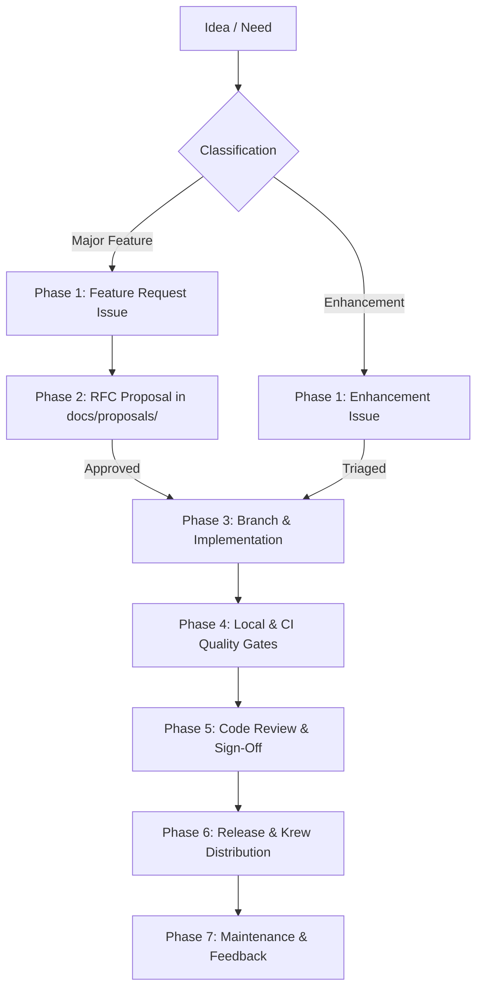

# Software Development Life Cycle (SDLC): Features & Enhancements

This document defines the formal Software Development Life Cycle (SDLC) for proposing, designing, implementing, verifying, and releasing **new features** and **enhancements** in `kubectl-neat`.

Because `kubectl-neat` processes live Kubernetes manifests used in production GitOps repositories, CI pipelines, and clusters, ensuring deterministic pruning, strict backward compatibility, and zero accidental data loss is critical.

---

## 1. Overview & Classification Matrix

Changes in `kubectl-neat` are categorized into three tracks:

| Track | Definition | Examples | Governance / Gate |
|---|---|---|---|
| **Major Feature** | Substantial new capability, major CLI expansion, or architectural change | CRD support, interactive diffing, new output formats, schema engine changes | Issue → RFC Proposal (`docs/proposals/`) → Maintainer Approval → Staged PRs |
| **Enhancement** | Refinement of existing behavior, additional default filtering, or minor CLI flags | Filtering new Kubernetes system tolerations, new mutating admission fields, performance gains | Issue → Issue Template Discussion → PR with Fixture Tests |
| **Bug Fix / Patch** | Restoring documented behavior or fixing manifest corruption/crashes | Edge-case JSON parsing panic, unpruned empty object shells | Issue → Direct PR with regression fixture |



---

## 2. The 7-Stage Feature & Enhancement Lifecycle

### Stage 1: Intake & Problem Definition
- **Objective**: Validate user demand, evaluate technical feasibility, and prevent scope creep.
- **Action**:
  - Open an issue using the [Feature Request](https://github.com/vitaltechmyanmar/kubectl-neat/issues/new?template=feature_request.yml) or [Enhancement Proposal](https://github.com/vitaltechmyanmar/kubectl-neat/issues/new?template=enhancement_proposal.yml) template.
  - Clearly articulate the Kubernetes resources affected and whether any breaking change is introduced.
- **Quality Gate 1 (Triage Approval)**: A maintainer reviews the issue, applies labels (`feature`, `enhancement`, `accepted`), and assigns a milestone or target release.

### Stage 2: Technical Design & Architecture Review (RFC)
- **Objective**: For major features or breaking changes, design before writing code.
- **Action**:
  - Fork `docs/proposals/template.md` to `docs/proposals/NNNN-feature-name.md`.
  - Detail:
    1. CLI flags / user interface.
    2. How the change integrates with the 9-step `Neat()` pipeline (`cmd/neat.go`) or the Kubernetes scheme default evaluator (`pkg/defaults/defaults.go`).
    3. Performance impact on large cluster manifests or multi-resource `List`s.
    4. Backward compatibility guarantees.
- **Quality Gate 2 (RFC Consensus)**: Minimum 1 core maintainer sign-off on the RFC before PR submission.

### Stage 3: Development & Fixture-Driven Engineering
- **Objective**: Implement the feature in Go following clean coding conventions and fixture-driven testing.
- **Branching Policy**:
  - Base branch: `main`
  - Feature branches: `feat/<feature-name>`
  - Enhancement branches: `enhance/<enhancement-name>`
- **Fixture-Driven Development (FDD) Requirement**:
  - Every modification to the `Neat()` pipeline or defaulting logic **must** introduce or update test fixtures under `test/fixtures/`:
    - `test/fixtures/<resource>-raw.yaml` (or `.json`): Real Kubernetes export containing redundant metadata, status, tolerations, or defaults.
    - `test/fixtures/<resource>-neat.json`: The mathematically expected minimal manifest.
- **Local Developer Standards**:
  ```bash
  # Format Go source code
  gofmt -s -w .

  # Run Go static analyzer
  go vet ./...

  # Verify compilation
  make build

  # Run unit test suite
  make test-unit

  # Run CLI E2E tests (requires bats)
  make test-e2e
  ```

### Stage 4: Automated CI Quality Gates
- **Objective**: Validate every PR automatically in GitHub Actions.
- **Automated Checks**:
  1. **Formatting**: `gofmt -s -d .` produces zero diffs.
  2. **Static Analysis**: `go vet ./...` completes without warnings.
  3. **Compilation**: `make build` cross-compiles cleanly.
  4. **Unit & Fixture Tests**: `make test-unit` verifies all core pipelines and fixtures.
  5. **Bats E2E**: Validates CLI binary execution, exit codes, stdin/stdout piping, and YAML/JSON output detection.

### Stage 5: Code Review & Governance Sign-Off
- **Objective**: Peer review to maintain code quality, maintainability, and security.
- **Review Criteria**:
  - Complete the [Pull Request Template](file:///.github/pull_request_template.md).
  - Confirm backwards compatibility with older Kubernetes manifests.
  - Verify error handling (e.g. invalid YAML, unparseable JSON, unknown GVK).
  - Ensure documentation is updated in `docs/usage.md` and `Readme.md`.
  - Ensure `CHANGELOG.md` is updated under `## [Unreleased]`.
- **Merge Strategy**: Squash and merge with conventional commit message (`feat: ...`, `enhance: ...`).

### Stage 6: Release Engineering & Artifact Distribution
- **Objective**: Safe, reproducible, and verifiable delivery to end users.
- **Versioning Strategy**: [Semantic Versioning 2.0.0](https://semver.org/):
  - `MAJOR`: Incompatible CLI interface or manifest output changes.
  - `MINOR`: Backward-compatible new features.
  - `PATCH`: Backward-compatible enhancements, bug fixes, or dependency bumps.
- **Release Steps**:
  1. Update `krew-template.yaml` with the target version.
  2. Finalize `CHANGELOG.md` section with release date.
  3. Tag the release: `git tag -a vX.Y.Z -m "kubectl-neat vX.Y.Z"`.
  4. Push tag to trigger `.github/workflows/release.yml` (GoReleaser).
  5. GoReleaser produces Darwin/Linux (amd64/arm64) archives and `checksums.txt`.
  6. Generate and verify Krew plugin manifest (`make release` generates `dist/kubectl-neat.yaml`).
  7. Publish release notes.

### Stage 7: Post-Release Monitoring & Maintenance
- **Objective**: Monitor adoption, address feedback, and manage deprecation.
- **Feedback & Triage**: Monitor GitHub issues for edge cases in production clusters.
- **Deprecation Policy**:
  - If a CLI flag or behavior is to be retired, announce deprecation in a MINOR release with a warning output.
  - Maintain support for at least 2 minor releases before complete removal in the next MAJOR release.

---

## 3. Fixture Testing Checklist for Pipeline Changes

When adding or altering behavior in `cmd/neat.go` or `pkg/defaults/defaults.go`:

1. [ ] Add raw Kubernetes object dump to `test/fixtures/<kind><num>-raw.yaml` or `.json`.
2. [ ] Add the expected neat output to `test/fixtures/<kind><num>-neat.json`.
3. [ ] Register the fixture test case in `cmd/neat_test.go` or `cmd/cmd_test.go`.
4. [ ] Run `make test-unit` to assert zero regressions across all historical fixtures.

---

## 4. Roles & Responsibilities

| Role | Responsibilities |
|---|---|
| **Contributor** | Submits Issue/RFC, develops feature according to guidelines, adds fixtures, updates docs. |
| **Reviewer / Maintainer** | Triages issues, reviews RFCs, conducts code reviews, verifies test coverage and CI results. |
| **Release Manager** | Verifies release checklist, signs/pushes tags, verifies GoReleaser artifacts and Krew manifests. |
